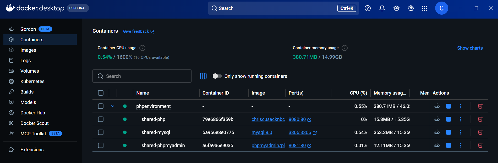
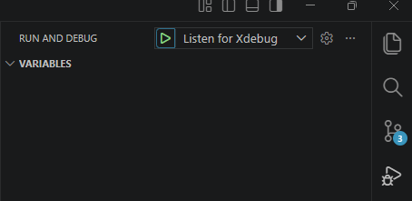

# NBCC PHP Development Environment
This repository is the NBCC Moncton Software Development PHP Development Environment.

## Setup
To build you development environment, follow the steps below:

1. Install Docker Desktop
    ```
    https://docs.docker.com/desktop/setup/install/windows-install/
    ```
2. Sign up for account on Docker Hub (optional)
3. For debugging, install the PHP Debug Extension for VSCode
    👉 PHP Debug (by DEVSENSE)
4. From root of this repo, run:
    ```
    docker compose up -d --build
    ```

Within Docker Desktop you will see your running containers

- phpenvironment
    - shared-php
    - shared-mysql
    - shared -phpmyadmin

    


4. Check if you **phpmyadmin** is working

    | Service    | URL                                            |
    | ---------- | ---------------------------------------------- |
    | phpMyAdmin | [http://localhost:8081](http://localhost:8081) |


6. Run the debugger and test breakpoints within the **myphp** project.
    

## Building Applications
1. Create a folder at the root call **apps**
2. Within the **apps** folder, create a folder for your application (app1)
3. Within your **application folder**, create a **public** folder
4. Within the **public** folder, create your application entry point.

## Adding Config Files
For the project you with to generate a config (.env) file

```
docker exec -it shared-php bash
cd /var/www/apps/<target project>
composer require vlucas/phpdotenv
```